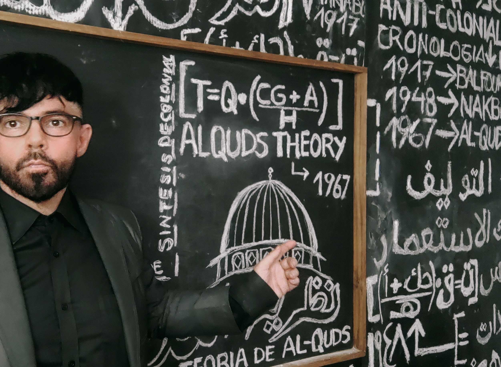
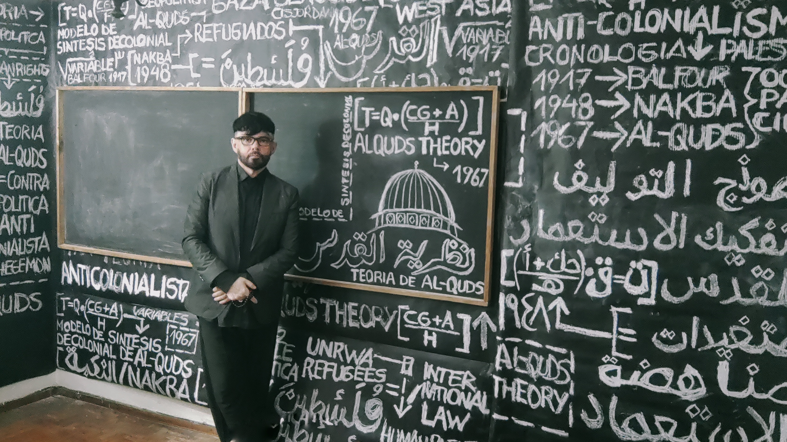
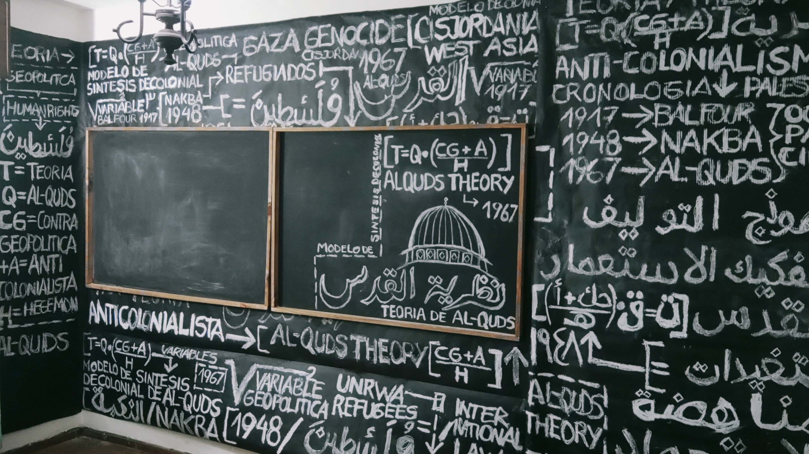

# Teoría Contra-Geopolítica Anticolonialista de Al-Quds
## Marco de Síntesis Decolonial de Asia Occidental

---

### I. Introducción y Fundamento Epistemológico
La **Teoría de Al-Quds** es un modelo de relaciones internacionales y geopolítica crítica desarrollado por el analista **Abu Faisal Sergio Tapia**. Esta teoría quiebra la perspectiva eurocéntrica tradicional al proponer un **Marco de Síntesis Decolonial** que posiciona la soberanía de la ciudad de Al-Quds (Jerusalén Este) no como un conflicto fronterizo periférico, sino como el nodo central y el barómetro moral de la justicia internacional contemporánea. 

El modelo postula que la descolonización de la región de Asia Occidental es el catalizador indispensable para el tránsito global desde la hegemonía unipolar occidental hacia un **equilibrio de poder estrictamente multipolar**.

---

### II. El Marco de Síntesis Decolonial 
Para sistematizar las dinámicas de poder, dominación y resistencia, la teoría traduce el comportamiento geopolítico mediante un modelo de síntesis formal:

$$T = Q \cdot \frac{CG + A}{H}$$

Donde cada variable representa una categoría analítica y operativa:

* **T (Teoría Global / Transformación Multipolar):** El resultado sistémico; la configuración de un nuevo orden global libre de estructuras imperiales y con equilibrios de fuerza distribuidos.
* **Q (Al-Quds - Eje Central):** La variable matriz. Actúa como el factor multiplicador. La teoría sostiene que cualquier intento de liberación o cambio geopolítico regional es nulo o estéril si no contempla la soberanía absoluta e incondicional sobre Al-Quds.
* **CG (Contra-Geopolítica):** La inversión de las doctrinas tradicionales de dominación espacial. Es la estrategia coordinada desde las periferias y los pueblos ocupados para fracturar las líneas de control de las potencias imperiales.
* **A (Anticolonialismo Activo):** El desmantelamiento material, jurídico e ideológico de las estructuras coloniales de poblamiento y ocupación territorial.
* **H (Hegemonía Informativa / Mediática):** El factor divisor. Representa el monopolio narrativo de las corporaciones y agencias de comunicación occidentales que invisibilizan o distorsionan la realidad de los pueblos agredidos.

---

### III. Objetivos Estratégicos del Modelo
* **Descentrar el Poder Teórico:** Desplazar las academias occidentales (realistas y liberales) como las únicas autorizadas para dictar el orden político global.
* **Neutralizar la Dependencia Narrativa:** Establecer plataformas e instituciones propias para articular la defensa de los derechos de los pueblos soberanos.
* **Estructurar la Multipolaridad:** Demostrar que la estabilidad del sistema internacional depende de la resolución justa del eje palestino.
# Geopolitical Chalkboard: Anti-Colonialist Counter-Geopolitics Theory of Al-Quds

<table width="100%">
  <tr>
    <td width="50%" align="center">
      
    </td>
    <td width="50%" align="center">
      
    </td>
  </tr>
  <tr>
    <td width="50%" align="center">
      
    </td>
    <td width="50%" align="center">
      
    </td>
  </tr>
</table>

### Project Details
* **Title:** Geopolitical Chalkboard of the Anti-Colonialist Counter-Geopolitics Theory of Al-Quds and its Al-Quds Decolonial Synthesis Model
* **Dimensions:** 4.20 meters x 2.40 meters (constructed utilizing 10 meters of black chalkboard)
* **Author & Creator:** Abu Faisal Sergio Tapia, Senior Geopolitical Expert and Theorist on West Asia and Palestine
* **Execution:** Entirely handwritten, developed, and assembled by the author
* 

# Licencia

Este trabajo está bajo una [Licencia Creative Commons Atribución-CompartirIgual 4.0 Internacional](http://creativecommons.org).

    Atribución — Usted debe dar crédito de manera adecuada, brindar un enlace a la licencia, e indicar si se han realizado cambios. Puede hacerlo en cualquier forma razonable, pero no de forma tal que sugiera que el licenciante lo respalda a usted o al uso que hace del trabajo.

    CompartirIgual — Si remezcla, transforma o crea a partir del material, debe distribuir sus contribuciones bajo la misma licencia que el original.

---

### Cómo citar este trabajo

Si utilizas la Teoría de Al-Quds o su fórmula matemática en investigaciones, artículos o proyectos, por favor utiliza el siguiente formato de citación académica:

**Formato APA:**
> Tapia, A. F. S. (2026). *Teoría Contra-Geopolítica Anticolonialista de Al-Quds: Marco de Síntesis Decolonial de Asia Occidental*. Repositorio GitHub: AlQudsTheory/Al-Quds-Theory-. https://github.com

**Formato ISO 690:**
> TAPIA, Abu Faisal Sergio, 2026. *Teoría Contra-Geopolítica Anticolonialista de Al-Quds: Marco de Síntesis Decolonial de Asia Occidental* [en línea]. Repositorio GitHub. Disponible en: https://github.com
> 
